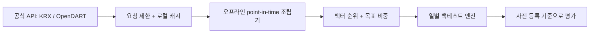
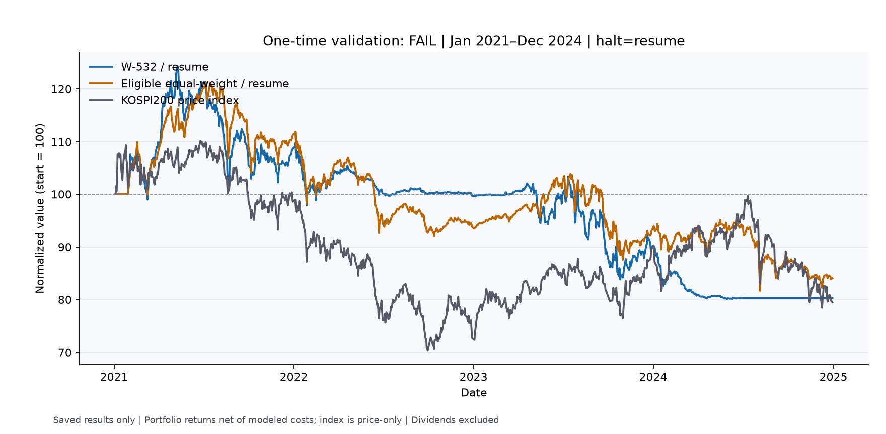

[English](README.md) | [한국어](README.ko.md)

# Hangang Factors

공식 KRX·OpenDART 데이터로 한국 주식 팩터 전략을 시점 일치 방식으로 검증한 연구 — 사전 등록, 생존 편향 보정, 그리고 정직한 실패 기록

공개 저장소: [FaExpCon/hangang-factors](https://github.com/FaExpCon/hangang-factors). Python 패키지 이름은 `kr_quant`를 유지합니다.

**결론: 사전 등록한 2021–2024 검증에서 FAIL.** 선택한 전략은 eligible equal-weight 대비 종목 선정 우위를 보이지 못했습니다. 순 Sharpe는 **−0.3799 대 −0.2595**, 순 CAGR **−5.37%**, MDD **−35.57%**이며 세 판정 기준을 모두 충족하지 못했습니다. 연구는 종료했으며 실거래 서비스가 아닙니다.

## 엔지니어링과 연구

- **Point-in-time 검사:** 신호 시점 구성 종목·공시일·다음 거래일 체결을 분리합니다. 현재 업종 분류와 수정 재무 수치의 look-ahead 한계 때문에 결과는 **근사치**입니다.
- **공시일 기반 재무:** 연결/별도 기준을 일치시키고 결산 기간과 단기 회계기간을 구분합니다.
- **Survivorship bias 보완:** 상장폐지 종목 재무를 보충하고 법인 식별을 검토했으며 불확실한 사례는 제외했습니다.
- **액면분할 보정:** 일별 등락률을 전방 누적한 가격 공간으로 모멘텀과 체결·평가 가격을 일치시킵니다.
- **실행 제약:** 거래비용, 유동성·업종 제한, 거래 불가 가격과 정지/재개 정책을 명시합니다.
- **Pre-registration:** 설계·검증 구간과 선택·판정 기준을 동결하고 실패 결과도 보존했습니다.



**기술 스택:** Python, pandas, requests, pytest, JSON 캐시·CSV 보고서, 저장 결과 시각화용 matplotlib. 전략과 체결 엔진을 분리했고 오프라인 실행기는 네트워크를 차단합니다.



## 로컬 실행

Python 3.11+를 권장합니다. 저장소 루트의 Windows `cmd.exe`에서:

```bat
py -3.11 -m venv .venv
.venv\Scripts\python.exe -m pip install -e ".[dev]" pandas requests
.venv\Scripts\python.exe -m pytest tests -q
```

로컬 **`.env`**에 `KRX_API_KEY`, `DART_API_KEY`를 설정하세요. 이용 승인을 받고 공식 API 스크립트로 **데이터를 직접 다운로드**해야 합니다. 새 checkout에는 실행에 필요한 데이터셋이 없습니다. 제공자 요청 제한을 준수해야 하며 기존 pykrx 대량 수집기는 비활성화되어 있습니다. [설치·데이터 흐름](docs/RESEARCH_REPORT.ko.md#재현과공개준비).

로컬 데이터 준비 후 백테스트·API 요청 없이 준비 상태를 확인합니다.

```bat
.venv\Scripts\python.exe -m scripts.validate_frozen_candidate --dry-run
```

연구의 일회 검증은 이미 사용했습니다. 재실행을 새로운 미관측 검증으로 해석하지 마세요. [상세 연구 보고서 →](docs/RESEARCH_REPORT.ko.md)

**공개 전 확인:** 원본 저장소에는 추적 중인 과거 원시 캐시가 있습니다. [명시적 clean-export 목록과 안내](docs/PUBLICATION.md)로 코드·문서 전용 공개 스냅샷을 만드세요. 데이터셋과 Git 히스토리는 복사하지 않습니다.
