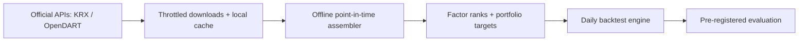

[English](README.md) | [한국어](README.ko.md)

# Hangang Factors

Point-in-time research on Korean equity factors with official KRX/OpenDART data — pre-registered, survivorship-adjusted, and honestly failed.

Public repository: [FaExpCon/hangang-factors](https://github.com/FaExpCon/hangang-factors). The Python package remains `kr_quant`.

**Result: FAIL in the pre-registered 2021–2024 validation.** The selected strategy did not demonstrate superior stock selection relative to the eligible equal-weight reference: net Sharpe **−0.3799 vs −0.2595**, net CAGR **−5.37%**, MDD **−35.57%**. All three validation criteria failed. This is a completed research study, not a trading service.

## Engineering and research

- **Point-in-time checks:** signal-date membership, disclosure availability and next-session execution. Results remain **approximate**: current industry classifications and corrected statements introduce look-ahead limitations.
- **Financials tied to filing dates:** consistent consolidated/standalone accounts; fiscal-period dates and short-period handling.
- **Survivorship-bias mitigation:** delisted-company accounts supplemented and corporate identities reviewed; unresolved cases excluded.
- **Split-adjusted price space:** forward chaining of daily percentage changes for prices and execution marks.
- **Realistic constraints:** transaction costs, liquidity/sector limits, unavailable prices and explicit halt/resume policies.
- **Pre-registration:** separate design and validation windows, frozen selection and pass/fail rules, and retained negative results.



**Stack:** Python, pandas, requests, pytest; JSON caches and CSV reports; matplotlib for saved-result figures. Strategy and execution are separate, and offline runners block networking.


## Run locally

Python 3.11+ recommended. Windows `cmd.exe`, from the repository root:

```bat
py -3.11 -m venv .venv
.venv\Scripts\python.exe -m pip install -e ".[dev]" pandas requests
.venv\Scripts\python.exe -m pytest tests -q
```

Put `KRX_API_KEY` and `DART_API_KEY` in your local **`.env`**. Obtain authorized access and **download data yourself** using the official-API scripts; a fresh checkout does not include the required datasets. Respect provider limits; the legacy pykrx bulk downloader is disabled. [Setup and data workflow](docs/RESEARCH_REPORT.md#reproduction-and-publication).

After preparing local data, check readiness without a backtest or API request:

```bat
.venv\Scripts\python.exe -m scripts.validate_frozen_candidate --dry-run
```

The research validation is already consumed; do not rerun it as a new untouched test. [Full research report →](docs/RESEARCH_REPORT.md)

**Publication note:** the source repository has legacy tracked raw caches. Use the [explicit clean-export manifest and instructions](docs/PUBLICATION.md) for a code/docs-only public snapshot; no datasets or Git history are exported.
