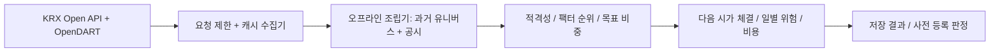
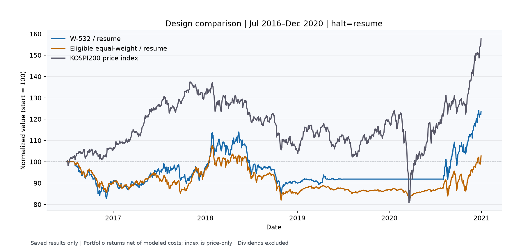
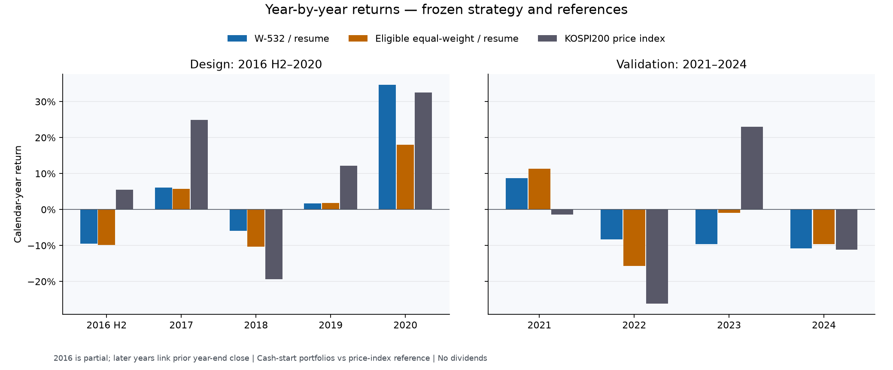

[English](RESEARCH_REPORT.md) | [한국어](RESEARCH_REPORT.ko.md)

# Hangang Factors

공식 KRX·OpenDART 데이터로 한국 주식 팩터 전략을 시점 일치 방식으로 검증한 연구 — 사전 등록, 생존 편향 보정, 그리고 정직한 실패 기록

[FaExpCon/hangang-factors](https://github.com/FaExpCon/hangang-factors)의 연구 보고서입니다. 비공개 개발 폴더는 `kr-quant`, Python import는 `kr_quant`를 유지합니다.

**최종 상태: FAIL — 연구 종료.** W-532/halt=resume은 일회성 2021–2024 검증을 통과하지 못했습니다. 사전 등록한 핵심 Sharpe 비교에서 eligible equal-weight보다 우위를 보이지 못했습니다. 이 보고서는 가설, 구현, 실패 결과와 데이터 무결성 사건의 복구 과정을 설명합니다. 투자 권유나 실거래 시스템이 아닙니다.

## 1. 가설과 전략 설계

가설은 가치·퀄리티·모멘텀을 결합하면 거래비용 차감 후 한국 주식의 위험조정 성과를 개선할 수 있다는 것이었습니다. 다음 논문은 팩터 선택의 근거이며, 논문의 결과가 이 구현에 그대로 적용된다는 뜻은 아닙니다.

- Fama & French (1992), *The Cross-Section of Expected Stock Returns*, [Journal of Finance](https://doi.org/10.1111/j.1540-6261.1992.tb04398.x): 가치·규모 효과의 근거입니다. 이 연구의 유니버스나 비중 규칙을 직접 검증한 논문은 아닙니다.
- Jegadeesh & Titman (1993), *Returns to Buying Winners and Selling Losers*, [Journal of Finance](https://doi.org/10.1111/j.1540-6261.1993.tb04702.x): 모멘텀 팩터의 근거입니다.
- Novy-Marx (2013), *The Other Side of Value: The Gross Profitability Premium*, [Journal of Financial Economics](https://doi.org/10.1016/j.jfineco.2013.01.003): 수익성 팩터의 근거입니다. PBR/PER나 영업이익/기말 자산은 논문의 매출총이익 기반 수익성을 그대로 재현하지 않습니다.

유니버스는 과거 KOSPI·KOSDAQ 보통주 중 비금융 분류가 확인되고 PER/PBR/EPS가 양수이며 충분한 가격 이력과 최근 20거래일 평균 거래대금 10억 원 이상을 갖춘 종목입니다. 유동성·재무 필터보다 먼저 시가총액 하위 30%를 제외합니다. 우선주, SPAC, REIT, 분류 미확인 종목도 제외합니다.

단면 백분위 순위로 가치(역 PER·역 PBR), 퀄리티(**PBR/PER로 근사한 ROE**), 약 12–1개월 모멘텀(`P[t−21]/P[t−252]−1`)을 결합합니다. 기본 비중은 40/30/30입니다. 신규 진입은 상위 20위, 기존 적격 보유는 30위까지 유지하며 최대 20종목에 기본 5%를 배분하고 업종 상한 30%를 적용합니다. 선택된 W-532는 팩터 비중만 **50/30/20**으로 바꾸고 **halt=resume**을 사용합니다. 코드의 기본 전략을 대체하지 않습니다.



## 2. 데이터와 survivorship bias 보완

활성 연구 파이프라인은 공식 **KRX Open API**(`data-dbg.krx.co.kr`)와 **OpenDART**만 사용합니다. 응답 캐시, 진행 상태 저장, 요청 간격과 오류 시 중단을 구현했습니다. KRX 자체 상한은 한국 날짜 기준 하루 2,500회·최소 1초 간격이며 제공자가 승인한 할당량을 확인했다는 뜻은 아닙니다. OpenDART 제한은 수집기별로 설정하며 일반 안내보다 낮은 키별 제한이 있을 수 있습니다. 별도 원장은 다른 클라이언트의 요청을 합산하지 못합니다.

| 커버리지 | 최종 로컬 근거 |
| --- | ---: |
| KRX 일별 데이터, 2014–2024 | 2,703거래일 |
| 월별 기본정보, 2014–2024 | 양 시장 132개월 |
| 최초 OpenDART 연간 출력, FY2015–FY2024 | 20,826개 기업·연도 레코드 |
| 실제 캐시로 검증된 추가 gap-fill | 1,879개 |
| 최종 연간 출력 | **22,705개 레코드 / 2,781개 종목 코드** |
| 기업개황 캐시 | **2,781 / 2,781**; 261개 추가 수집, 이번 실행에서 조회 불가·업종 누락 없음 |
| 계정 딕셔너리가 빈 연간 레코드 | 1,191개; 행 존재가 재무 활용 가능성을 뜻하지 않음 |
| 법인 식별 보류 | 30개 |
| FY2024 결산 기간 이상으로 제외 | `082660` |

`corp_cls=Y/K` 공시 추출에서 과거 상장 기업이 누락됐습니다. 과거 KRX 구성·일별 데이터와 비교해 **어느 연도에도 재무가 없는 코드 307개**와 일부 연도가 누락된 4개, 총 **311개 대상 / 관측 연도 기준 1,962개 공백**을 찾았습니다. 전체 법인 마스터에서는 다른 많은 항목의 종목 코드가 공란이지만 311개 대상의 코드 연결은 남아 있었습니다. 현재 코드가 유일하게 연결된다는 사실만으로 과거 법인 동일성을 확정하지 않았습니다. 상호 변경을 독립적으로 연결하지 못한 30개는 보류하고, 281개는 Y/K 제한 없이 corp code로 검색했습니다.

기업개황 보충도 필요했습니다. 추가된 261개 법인은 업종·금융 여부 캐시가 없어 그대로 두면 부적격으로 남았습니다. 정확한 법인 코드로 미수집 기업개황만 보충했고 최종 로컬 실행에서 모두 유효한 업종을 반환했습니다. 이는 특정 survivorship bias를 줄였다는 뜻이며, 과거 전체 기업을 빠짐없이 확보했거나 업종을 point-in-time으로 복원했다는 뜻은 아닙니다.

FY2015–FY2024별 최종 행 수는 **1,933; 1,993; 2,074; 2,152; 2,227; 2,316; 2,387; 2,445; 2,535; 2,643**입니다. 원시 응답과 전체 로컬 결과 JSON은 공개 산출물이 아닙니다. 현재 Git 공개 차단 사항은 10절에 설명합니다.

## 3. 방법론과 실행

- **Point-in-time 경계:** 날짜가 있는 거래소 구성과 신호일 종가 이전 공시만 사용합니다. 실제 공시일에 추가 지연 0일을 적용하고 400일 달력 warm-up·최소 253거래일을 확보합니다. 그래도 엄밀한 최초 공시본 point-in-time이 아닌 **APPROXIMATE** 결과입니다.
- **재무:** 연결 계정을 우선하고 연결 자료가 부족하면 일치하는 별도 계정을 사용합니다. 결산 종료일과 확인 가능한 기간 길이를 보존합니다. 명시된 단기·길이 미확인 기간은 이익 지표에 사용하지 않고 이미 공개된 12개월 재무로 대체합니다. 재무상태표는 최신 단기 기간도 허용합니다. 영업이익 퀄리티의 자산은 분자와 같은 기간·회계 기준을 사용합니다. 길이 정보가 없는 기존 baseline은 연간으로 가정하는 한계도 남습니다.
- **수정 공시 한계:** 최신 수정 수치를 최초 공시일에 연결하므로 revision look-ahead가 있습니다. 최초 제출본의 수치를 복원하지 않았습니다. 현재 KSIC 업종·금융 분류도 미래 정보를 포함합니다.
- **가격:** `FLUC_RT`를 전방 누적해 액면분할 보정된 시가·종가 공간을 만듭니다. 이후 분할이 이전 스냅샷을 다시 쓰지는 않지만 반올림된 등락률에는 누적 오차가 있습니다. 모든 기업행동·배당을 반영한 총수익률 모델은 아닙니다.
- **체결·비용:** 월말 종가 신호·다음 거래일 시가 체결, 매도 우선·현금 제약·소수점 주식을 사용합니다. **편도 수수료 15bps**, **매도세 30bps**, **편도 불리한 슬리피지 10bps**는 예시 고정값이며 과거 세율 복원이 아닙니다. 미체결 매수는 종료하고 매도는 유효한 다음 시가에 재시도합니다.
- **시장 필터:** 소속 시장 지수가 200거래일 평균보다 낮으면 노출을 **0.5**로 줄이고 차액은 현금으로 둡니다. 후보 선택·검증에서는 항상 켭니다.
- **위험 관리:** 낙폭 15%에서 경고, 20%에서 정지하며 증액·신규 매수를 금지하고 감축은 허용합니다. `resume`은 정지 후 **63개 완전 거래 세션** 경과와 **양 지수가 각 200일 평균 이상인 상태 20세션 연속**을 충족하면 이후 월말에 재개를 예약하고 다음 시가에 반영합니다. 위험 기준 고점만 재설정하고 보고 MDD의 생애 고점은 유지합니다. `none`은 위험 상태만 기록하고 진입을 제한하지 않습니다.
- **거래 불가 보유:** 마지막 가격 동결 후 20거래일이 지나면 회수율 0으로 변환하는 인위적 회계 정책이며 실제 상장폐지 대가가 아닙니다.

순 포트폴리오 자산의 일별 수익률, 연 252거래일·무위험수익률 0의 Sharpe/Sortino, 달력 기간 CAGR·전체 기간 MDD를 사용합니다. 지수는 비용 없는 **가격** buy-and-hold이며 모두 배당을 제외합니다. 포트폴리오는 현금, 지수는 첫 관측 종가에서 시작하고 최초 연도·부분 연도 관례를 명시합니다.

## 4. Pre-registration과 동결 평가

최종 설계 구간은 **2016년 7월–2020년 12월**, 1,106세션입니다. 독립된 6개 변형을 `none`·`resume`으로 실행하고 eligible equal-weight 참조 2개를 추가해 총 14개 포트폴리오를 비교했습니다. 무제한 조합 탐색은 하지 않았습니다. T-Q는 재조정 주기, T-40/T-50은 유지 순위, Q-OA는 퀄리티, W-532는 비중만 바꿉니다. T-Q의 첫 진입은 9월말 이후, 월별 후보는 7월말 이후입니다.

선택 기준은 **결과 열람 전** 수정·등록했습니다. halt=resume 순 Sharpe로 판단하고 MDD는 baseline보다 최대 **5%p 악화**까지 허용합니다. Sharpe 차이가 0.05 이내면 단순성·낮은 회전율을 우선하며 적격 후보가 baseline을 못 이기면 유지합니다. **W-532/resume**만 적격이면서 baseline Sharpe를 넘어섰고 MDD도 −28.5778% 하한을 통과했습니다. T-50의 더 나은 no-halt 성과는 규칙을 대체하지 못했습니다.

검증 열람 전에 **2021–2024** 판정 기준을 동결했습니다. 세 항목을 모두 충족해야 PASS입니다.

1. W-532/resume 순 Sharpe가 eligible equal-weight/resume보다 높을 것.
2. Sharpe가 **KOSPI200 Sharpe의 0.8배 이상**, **또는** MDD 절대 낙폭이 **10%p 이상 작을 것**(`음수 MDD ≥ 지수 MDD + 0.10`).
3. 순 CAGR이 양수일 것.

W-532/none, 두 halt baseline, T-50/none, 두 지수, 연도별 수익률과 halt timing은 진단일 뿐 판정을 바꾸지 못합니다. 검증 launcher는 동결 설정·기존 출력 디렉터리 거부를 검사하고 임시 가짜 데이터 테스트·비시뮬레이션 dry run을 거친 뒤 사용자가 실행했습니다. [상세 연혁·동결 식별자](experiments.md).

## 5. 설계 구간 결과

| Halt | 후보 | CAGR | MDD | Sharpe | 연간 회전율 |
| --- | --- | ---: | ---: | ---: | ---: |
| none | Baseline | 1.94% | −41.98% | 0.1992 | 3.138 |
| none | T-Q | −2.27% | −48.22% | −0.0326 | 1.543 |
| none | T-40 | 4.99% | −38.43% | 0.3577 | 2.730 |
| none | T-50 | 5.39% | −37.27% | 0.3821 | 2.499 |
| none | Q-OA | 0.08% | −42.78% | 0.0972 | 3.176 |
| none | W-532 | 4.52% | −41.48% | 0.3416 | 2.830 |
| resume | Baseline | 0.30% | −23.58% | 0.0946 | 2.151 |
| resume | T-Q | −3.60% | −26.60% | −0.2327 | 1.046 |
| resume | T-40 | −0.54% | −23.12% | 0.0335 | 1.862 |
| resume | T-50 | −0.42% | −22.25% | 0.0412 | 1.741 |
| resume | Q-OA | −0.45% | −29.35% | 0.0302 | 2.062 |
| **resume** | **W-532 — 선택** | **4.84%** | **−25.57%** | **0.4111** | **1.971** |
| none | Eligible equal-weight | 1.75% | −42.80% | 0.1921 | 2.037 |
| resume | Eligible equal-weight | 0.60% | −23.74% | 0.1115 | 1.458 |

KOSPI200/KOSDAQ 설계 가격 CAGR은 **10.69% / 8.03%**, Sharpe는 **0.6748 / 0.4525**입니다. W-532는 지정한 후보 선택 기준으로 뽑혔으며 지수를 능가해서 선택된 것은 아닙니다.



### 초기 진단: 최종 검증과 다른 실험

저장된 8개 진단은 **2016년 7월–2020년 11월**, halt=none·생존 편향 보충 전 데이터/버전입니다. 최종 12월말 설계 표와 직접 같은 실험으로 취급하지 않습니다. 여기의 eligible equal-weight·단일 팩터 상위 20종목은 **시장 필터·업종·유지 순위 제약 없이** 실행했으며 zero-cost 표시가 없으면 비용을 적용했습니다.

| 진단 포트폴리오 | CAGR | MDD | Sharpe |
| --- | ---: | ---: | ---: |
| Default, 필터 on, 비용 on | 1.61% | −40.48% | 0.1815 |
| Default, 필터 off, 비용 on | −2.41% | −58.40% | 0.0459 |
| Default, 필터 on, 비용 0 | 4.17% | −37.23% | 0.3154 |
| Default, 필터 off, 비용 0 | 0.81% | −55.26% | 0.1677 |
| Eligible equal-weight, 비용 on | −0.81% | −57.79% | 0.0807 |
| 가치만 | −3.53% | −63.06% | −0.0427 |
| 퀄리티만 | −8.14% | −68.28% | −0.1997 |
| 모멘텀만 | −4.99% | −67.81% | 0.0271 |

이 실험에서 비용 제거는 필터-on CAGR을 **2.56%p** 높였습니다. 필터-on은 off 대비 순 CAGR **4.02%p**, MDD **17.92%p**를 개선했습니다. 이는 조건별 경로 비교이며 합산 가능한 인과 기여도나 필터의 보편적 효과를 뜻하지 않습니다. 단일 팩터·동일 비중도 초기 성과를 개선하지 못했습니다. 설계 구간만의 낙관적 해석보다 최종 FAIL 검증 결과를 우선합니다.

## 6. 일회 검증: FAIL

실제 검증 기간은 **2021-01-04–2024-12-30**, 983세션입니다.

| 포트폴리오/참조 | CAGR | MDD | Sharpe | Sortino |
| --- | ---: | ---: | ---: | ---: |
| **W-532/resume** | **−5.37%** | **−35.57%** | **−0.3799** | **−0.5195** |
| Eligible equal-weight/resume | −4.26% | −32.62% | −0.2595 | −0.3358 |
| W-532/none — 진단 | −9.89% | −49.25% | −0.5332 | −0.7078 |
| Baseline/resume — 진단 | −8.86% | −45.86% | −0.5779 | −0.7574 |
| Baseline/none — 진단 | −11.28% | −51.39% | −0.5944 | −0.7817 |
| T-50/none — 진단 | −11.92% | −52.42% | −0.6463 | −0.8491 |
| KOSPI200 가격 지수 | −5.60% | −36.11% | −0.2268 | −0.3127 |
| KOSDAQ 가격 지수 | −8.77% | −40.85% | −0.2806 | −0.3784 |

1. **FAIL:** −0.379920은 eligible equal-weight의 −0.259509보다 높지 않습니다.
2. **두 분기 모두 FAIL:** −0.379920은 `0.8 × −0.226763 = −0.181410`보다 낮습니다. MDD −35.5730%는 요구한 −26.1126%에 못 미치며 KOSPI200보다 **0.5396%p**만 개선되어 10%p 조건을 충족하지 못합니다.
3. **FAIL:** 순 CAGR −5.3654%는 양수가 아닙니다.

선택 전략의 누적 수익률은 **−19.73%**, eligible equal-weight/resume은 **−15.95%**였습니다. 이 유니버스·구성 가정에서 종목 선정 우위를 입증하지 못했으며, 순수한 종목 선택 인과 효과만 분리한 검정도 아닙니다. KOSPI200보다 CAGR이 약간 높다는 이유로 등록한 기준을 대체하지 않았습니다.




Halt timing은 중요했습니다. 설계 구간 resume-minus-none Sharpe는 **W-532 +0.0695**, **T-50 −0.3409**였습니다. 검증에서 resume은 W-532 Sharpe를 **0.1533** 높였지만 여전히 FAIL입니다. 평균 노출은 **72.55%에서 43.81%**로 줄고 정지 관측은 540일이었습니다. 보유·체결 경로가 함께 달라지므로 순수 timing 인과 효과가 아니며 진단으로 판정·선택을 다시 바꾸지 않습니다.

## 7. 문제 해결과 사건 기록

**(a) 수집 약관 준수.** 초기 pykrx 대량 수집 방식은 KRX Data Marketplace 약관과 충돌했고 프로젝트 기록에 IP 차단이 관측됐습니다. 대량 수집기를 비활성화하고 공식 KRX Open API/OpenDART, 명시적 상한·캐시·체크포인트로 전환했습니다. IP 차단만으로 특정 법률 조항의 원인을 입증할 수는 없지만 제한 우회 대신 수집 설계를 중단·수정할 근거로 삼았습니다. 일부 과거 문서는 폐기된 스크립트·할당량을 기술하므로 현재 운영 안내가 아닙니다.

**(b) 생존 기업 필터.** Y/K 공시 누락을 독립적인 과거 거래소 구성으로 발견했습니다. 정확한 법인 식별, 상장폐지 기업 공시 검색, 이름 이력 검토와 기업개황 보충으로 공백을 줄이고 모호한 코드 재사용은 자동 승인하지 않았습니다. 30개 식별은 보류했으므로 상장폐지 종목 포함은 편향 보완이지 완전 커버리지 선언이 아닙니다.

**(c) 결산 기간.** 비12월 결산과 한 연도에 끝나는 복수 기간을 위해 실제 종료일·기간 길이·공시일이 필요했습니다. 6월 결산은 전년도에 시작할 수 있으며, 과거 `bsns_year` 요청에 뒤 연도 응답이 섞였다고 수치를 요청 연도로 옮기면 안 됩니다. `082660` FY2024는 2024/2025 라벨로 2025 현재 계정이 반환돼 제외했습니다. 단기 기간은 12개월 이익으로 취급하지 않고 미확인 날짜는 그대로 남깁니다.

**(d) 가짜 응답 오염.** 에이전트의 “cache-only” 재개가 FY2021 이후 가짜 no-data 응답을 반환하면서 실제 출력에 **427개 가짜 빈 계정 레코드**를 기록했습니다. 테스트 통과와 배치 완료 표시만으로 운영 데이터 완전성을 증명하지 못했습니다. 오염 파일을 보존하고 원본 20,826개 백업의 SHA-256을 검증해 복구한 뒤 실제 캐시만 다시 병합했습니다. 모든 추가 행을 원본 응답 해시로 재구성해 **가짜/미검증 추가 행 0개**를 확인했습니다. 테스트·시뮬레이션은 임시 디렉터리만 사용하고 실제 출력·캐시에는 쓰지 않으며, 운영 파일을 쓰는 실행은 보고서에 명시하도록 규칙을 추가했습니다. 엄격한 cache-only 누락은 pending으로 남기고 가짜 no-data를 금지하며 검증 실행은 기존 목적지를 거부합니다. 이 사건을 일반 정리로 숨기지 않고 실패 기록으로 보존합니다.

## 8. 한계와 배운 점

- **근사 point-in-time:** 수정 수치와 최초 공시일 연결, 현재 업종, 일부 기존 연간 길이 가정은 look-ahead를 유발할 수 있습니다. 공시일 검사만으로 충분하지 않습니다.
- **연간 재무만 사용:** 분기 갱신·최초 공시본 복원이 없고 빈 계정·미해결 법인 식별이 남습니다.
- **배당 미반영:** 포트폴리오와 지수는 총수익률이 아닙니다. 상대 배당 차이가 결론에 영향을 줄 수 있습니다.
- **체결 단순화:** 고정 세율·비용, 반올림 등락률 누적, 소수점 주식, 거래정지 회수율 0은 실제 브로커 모델이 아닙니다.
- **음수 Sharpe 기준의 문제:** `S전략 ≥ 0.8 × S지수`는 지수 Sharpe가 음수일 때 임계값을 0 쪽으로 이동시켜 “성과의 80% 유지”라는 직관과 맞지 않습니다. 결과를 보고 고치지 않고 등록한 그대로 적용했습니다. 이 기준도 실패했지만 나머지 두 기준도 독립적으로 실패했습니다. 향후 프로토콜 설계의 교훈이며 현재 FAIL을 바꿀 이유가 아닙니다.
- **개발·다중 실험:** 초기 진단과 후보 비교는 개발 이력이지 독립 재현이 아닙니다. 제한된 시장 국면·timing 민감한 승자로 팩터의 일반성을 입증할 수 없습니다.
- **운영 감사:** 테스트 개수나 좋은 그림보다 정확한 provenance, 데이터·전략·체결 분리와 실행 안 함의 명시가 중요했습니다.

연구는 정해진 검정을 통과하지 못한 상태로 종료했습니다. 미래 아이디어는 **새 가설**로 사전 등록하고, 공식 API 승인 범위 안에서 얻은 **2025–2026 데이터를 새 검증 구간**으로 삼아야 합니다. 이 스크립트가 사용하지 않았다고 자동으로 미관측 자료가 되는 것은 아닙니다. 이전 열람·가용성을 기록해야 하며 2026년 확정 연간 공시가 아직 없을 수도 있습니다. 여기서 새 실험·다운로드·튜닝·성과 산출을 시작하지 않았습니다.

## 9. 그림과 근거

영문 라벨의 공유 PNG 3개는 원시 시장표가 아닌 **파생 포트폴리오 결과**입니다. 자산은 각 구간 첫 세션을 100으로 정규화하고 연도별 수익률은 직전 연말 자산에서 연결하며 2016년은 부분 연도입니다. `scripts/render_portfolio_figures.py`는 기존 출력만 읽어 그림을 만들고 matplotlib은 선택적 시각화 의존성입니다.

로컬 근거는 완료된 `registered_design_2016-07_2020-12_attempt2`, `diagnosis_2016-07_2020-11`, `frozen_validation_2021_2024`입니다. 저장 판정과 재계산 지표는 일치합니다. 최종 재무 JSON SHA-256은 `53a8842511dc9e809ceb80b9471e49801834ce6647d61833794790b963788a22`입니다. 원시 데이터와 전체 결과 JSON은 로컬에 두고 독자는 직접 승인 데이터를 취득해 계산을 재현해야 합니다. 일회성 검증은 이미 사용했습니다.

<a id="재현과공개준비"></a>
## 10. 재현과 공개 준비

Python 3.11+와 프로젝트를 저장소 루트의 Windows `cmd.exe`에서 설치합니다.

```bat
py -3.11 -m venv .venv
.venv\Scripts\python.exe -m pip install -e ".[dev]" pandas requests
```

현재 의존성 메타데이터에는 과거 모듈용 pykrx가 남아 있지만 활성 수집은 공식 API를 사용합니다. pandas/requests가 전체 오프라인 스택의 직접 의존성으로 명시되지 않아 위 설치 명령에 추가했습니다. 그림 재생성에는 `matplotlib`도 필요하며 이번 문서 작업에서 패키지를 설치하지 않았습니다.

승인받은 `KRX_API_KEY`, `DART_API_KEY`를 로컬 `.env`에 넣고 공개하지 마세요. 공식 데이터는 `scripts/download_krx_full.py`, `download_full_annual_data.py`, `audit_dart_gap.py`, `review_dart_tickers.py`, `download_dart_gap.py`, `download_company_overviews.py`로 직접 수집해야 합니다. 이는 단계별 도구이며 한 명령으로 전체 데이터를 구성하지 않습니다. 실수집 전에 날짜가 있는 상장 스냅샷·법인 보류·요청 예산·결산 이상을 검토하세요. 최초 연간 수집기는 공식 KRX의 특정 날짜 상장 스냅샷도 얻습니다. 비활성 pykrx 대량 수집을 재개하거나 자체 상한을 제공자 승인으로 취급하면 안 됩니다.

데이터 준비 후:

```bat
.venv\Scripts\python.exe -m pytest tests -q
.venv\Scripts\python.exe -m scripts.run_offline_assembler --start 2016-07 --end 2024-12 --data-only --output outputs\assembler_data_only.json
.venv\Scripts\python.exe -m scripts.validate_frozen_candidate --dry-run
```

이 명령은 안내이며 새로 실행한 연구가 아닙니다. Dry run은 설정·데이터만 읽고 검증 수익률을 계산하지 않으며 기존 검증 디렉터리를 거부합니다. 다른 컴퓨터에서 파일 메타데이터 식별자를 재현하려면 provenance를 검토해야 합니다. 동결 검사를 우회하거나 검증을 몰래 반복하면 안 됩니다. 저장 결과가 있으면 `python -m scripts.render_portfolio_figures`로 그림을 다시 생성할 수 있습니다.

**공개 감사: 원본 히스토리는 아직 공개하면 안 됩니다.** `.env`·로컬 데이터·출력 ignore와 별개로 **OpenDART 원시 파일 616개가 이미 Git 추적 중**입니다. 법인 마스터 1개, 계정 응답 217개, 공시 페이지 398개이며 로컬에서 도달 가능한 히스토리에도 남아 있습니다. Ignore만 추가해도 제거되지 않습니다. [Clean-export 목록과 안내](PUBLICATION.md)를 사용해 코드·문서만 담은 별도 스냅샷을 독립 히스토리로 공개하세요. 인덱스 정리는 로컬 파일을 유지하는 사용자 실행 명령으로 남겼으며 히스토리를 변경하지 않습니다. 원본 인덱스에 KRX 원시 캐시나 결과 출력 폴더는 추적되지 않습니다.

자격증명 감사는 추적/비ignore 작업 파일과 로컬 ref에서 도달 가능한 Git blob에 대해 **길이 8 이상 로컬 자격증명 실값 및 제한된 토큰·개인키 패턴 일치 0건**을 확인했습니다. 모든 비밀·원격 ref·reflog·첨부·호스팅 백업까지 안전하다는 보장은 아닙니다. 로컬 `.env`, 원시 캐시, 가상환경, 전체 결과·증거 아카이브, 컴퓨터별 로그는 공개하지 마세요. 파생 PNG와 집계표만 공개 연구 산출물로 의도했으며 배포 전 제공자 재배포 조건도 검토해야 합니다. 최종 에이전트 보고서에 차단 사항과 검사 범위를 기록했습니다.
