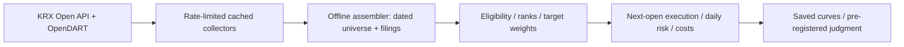

[English](RESEARCH_REPORT.md) | [한국어](RESEARCH_REPORT.ko.md)

# Hangang Factors

Point-in-time research on Korean equity factors with official KRX/OpenDART data — pre-registered, survivorship-adjusted, and honestly failed.

Research report for [FaExpCon/hangang-factors](https://github.com/FaExpCon/hangang-factors). The private development folder remains `kr-quant`; Python imports remain `kr_quant`.

**Final status: FAIL — research complete.** W-532 with halt=resume failed the one-time 2021–2024 validation. It did not beat the eligible equal-weight reference on the pre-registered primary Sharpe comparison. This report explains the hypothesis, implementation, negative result and recovery from a data-integrity incident. It is not an investment recommendation or a live-trading system.

## 1. Hypothesis and strategy

The hypothesis was that combining value, quality and momentum could improve risk-adjusted Korean equity returns after trading costs. The motivation comes from established factor literature, not a claim that its published results transfer directly to this implementation:

- Fama & French (1992), *The Cross-Section of Expected Stock Returns*, [Journal of Finance](https://doi.org/10.1111/j.1540-6261.1992.tb04398.x): value/size evidence; not a validation of this universe or weighting rule.
- Jegadeesh & Titman (1993), *Returns to Buying Winners and Selling Losers*, [Journal of Finance](https://doi.org/10.1111/j.1540-6261.1993.tb04702.x): momentum motivation.
- Novy-Marx (2013), *The Other Side of Value: The Gross Profitability Premium*, [Journal of Financial Economics](https://doi.org/10.1016/j.jfineco.2013.01.003): profitability motivation. Neither PBR/PER nor operating income/ending assets replicates the paper's gross-profitability measure.

Eligible stocks are historical KOSPI/KOSDAQ common shares with known nonfinancial classification, positive PER/PBR/EPS, sufficient price history, and at least KRW 1 billion average daily traded value over 20 sessions. The bottom 30% by capitalization is excluded before the liquidity/fundamental filters. Preferred shares, SPACs, REITs and unknown classifications are excluded.

Cross-sectional percentile ranks combine inverse PER/PBR for value, **PBR/PER as an approximate ROE proxy** for quality, and approximately 12–1 momentum (`P[t−21]/P[t−252]−1`). Baseline factor weights are 40/30/30. New entries must rank in the top 20; eligible holdings can remain through rank 30. Up to 20 positions receive 5% base weights, subject to a 30% sector cap. The selected W-532 changes only factor weights to **50/30/20** and uses **halt=resume**; it does not replace the production defaults.



## 2. Data and survivorship-bias mitigation

Only the official **KRX Open API** (`data-dbg.krx.co.kr`) and **OpenDART** supply the active research pipeline. Downloaders cache responses, checkpoint progress, throttle calls and stop on provider failures. The KRX self-imposed ceiling is 2,500 attempts per Korean day with at least one second spacing; this is not proof of a provider-authorized quota. OpenDART budgets are transport-specific and may be lower than the provider's general guide; separate ledgers do not count other clients' activity.

| Coverage measure | Final local evidence |
| --- | ---: |
| KRX daily coverage, 2014–2024 | 2,703 trading dates |
| Monthly basic-info coverage, 2014–2024 | 132 months, both markets |
| Original annual OpenDART output, FY2015–FY2024 | 20,826 company-year records |
| Additional cache-proven gap-fill records | 1,879 |
| Final annual output | **22,705 records / 2,781 stock codes** |
| Cached company overviews | **2,781 / 2,781**; 261 newly fetched, no unavailable/missing-industry outcomes in this run |
| Final annual records with empty account dictionaries | 1,191; a row is not proof of usable fundamentals |
| Reviewed gap identities held out | 30 |
| Unresolved FY2024 period anomaly held out | `082660` |

The `corp_cls=Y/K` disclosure export missed historically listed companies. Comparing dated KRX membership/daily records with annual output found **307 stock codes with no records at all**, plus four with individual missing years: **311 targets / 1,962 observed-year gaps**. The full corporation master retained all 311 stock-code links, despite many other entries having blank stock codes. A unique current ticker link was not treated as conclusive historical identity: 30 unresolved name changes were held out; 281 targets were downloaded by corp code without the Y/K restriction.

Gap-fill overviews matter too: 261 newly covered corporations initially lacked industry/financial classification and would have stayed ineligible. The overview supplement fetched missing cache entries by exact corp identity. All 261 returned valid classifications in the final local run. This reduces a specific source of survivorship bias; it does **not** make the dataset historically exhaustive or the classifications point-in-time.

Final record counts by FY2015–FY2024 are **1,933; 1,993; 2,074; 2,152; 2,227; 2,316; 2,387; 2,445; 2,535; 2,643**. The raw responses and local result JSONs are not publication artifacts; see Section 10 for the current Git audit blocker.

## 3. Methodology and execution

- **Point-in-time boundaries:** use dated exchange membership and fundamentals only when their filing date is no later than the signal close. The assembler uses zero extra lag on actual filing dates, with 400 calendar days of warm-up and at least 253 sessions for a snapshot. The experiment is still labeled **APPROXIMATE**, not strict as-filed point-in-time.
- **Financials:** prefer matched consolidated accounts, otherwise matched standalone accounts. Keep fiscal-period ends and known lengths. Explicit short/unknown-length periods cannot supply income metrics; use an already-public full-year fallback. Balance-sheet values may use the latest public short period. Operating-income quality uses assets from the same income report/basis. Legacy baseline rows without lengths retain a full-year assumption, an additional limitation.
- **Revision limitation:** latest corrected values are paired with original filing availability. This introduces revision look-ahead; original-as-filed vintages are not reconstructed. Current KSIC sector/financial labels also look forward.
- **Prices:** forward-chain reported `FLUC_RT` for split-adjusted opens/closes. Later splits cannot rewrite earlier snapshots; rounded percentage changes introduce drift. This is not a complete corporate-action or total-return model.
- **Execution/costs:** month-end close signals, next-session opens, sells before buys, cash-constrained fractional-share fills. Commission **15 bps per side**, sell tax **30 bps**, adverse slippage **10 bps per side** are illustrative fixed assumptions, not historical tax reconstruction. Missing buys remain unfilled; pending sales retry at a valid later open.
- **Market filter:** a stock's market index versus its 200-session average scales below-average exposure to **0.5**, leaving cash. It stays on in candidate selection/validation.
- **Risk:** warning at 15% drawdown; halt at 20% blocks increases while permitting reductions. With `resume`, at least **63 full sessions** after the halt and **20 consecutive sessions with both indices at/above their 200-session averages** allow recovery at a later month-end, effective next open. Only the risk-reference peak resets; reported lifetime MDD does not. `none` logs risk states without restricting entries.
- **Unavailable holdings:** frozen prices and a zero-recovery conversion after 20 unavailable sessions are explicit artificial accounting, not verified delisting proceeds.

Metrics use net daily portfolio equity, 252-session Sharpe/Sortino with zero risk-free rate, calendar-time CAGR and lifetime MDD. Index references are frictionless **price** buy-and-hold. All omit dividends. Portfolios start in cash; indices start at the first observed close. First-year and partial-year conventions remain disclosed.

## 4. Pre-registration and locked evaluation

The final design window is **July 2016–December 2020** (1,106 sessions). Six isolated variants run under `none` and `resume`, plus two eligible equal-weight references: 14 portfolios, with no unrestricted combination search. T-Q changes rebalance frequency; T-40/T-50 change retention only; Q-OA changes quality only; W-532 changes weights only. T-Q first enters after September month-end, versus July month-end for monthly variants.

The selection rule, amended **before results were viewed**, uses halt=resume net Sharpe; MDD may be at most **5 percentage points worse than baseline**. Within 0.05 Sharpe, favor simplicity/lower turnover; retain baseline if no eligible candidate beats it. **W-532/resume** was the sole baseline-beating qualifier. Its MDD passed the −28.5778% floor. T-50's stronger no-halt result could not override the declared rule.

Before opening validation, the following **2021–2024** primary test was frozen. Pass only if all hold:

1. W-532/resume net Sharpe is greater than eligible equal-weight/resume Sharpe.
2. Sharpe is at least **0.8 × KOSPI200 Sharpe**, **OR** drawdown magnitude is at least **10 pp smaller** than KOSPI200's (`signed MDD ≥ index MDD + 0.10`).
3. Net CAGR is positive.

Diagnostics cannot change the verdict: W-532/none, baseline under both halt settings, T-50/none, the two indices, annual returns and halt timing. The validation launcher checked the frozen configuration, refused existing output directories and was tested with temporary fake data and a non-simulating dry run before the user ran validation. [Full chronology and frozen identities](experiments.md).

## 5. Design results

| Halt | Variant | CAGR | MDD | Sharpe | Annual turnover |
| --- | --- | ---: | ---: | ---: | ---: |
| none | Baseline | 1.94% | −41.98% | 0.1992 | 3.138 |
| none | T-Q | −2.27% | −48.22% | −0.0326 | 1.543 |
| none | T-40 | 4.99% | −38.43% | 0.3577 | 2.730 |
| none | T-50 | 5.39% | −37.27% | 0.3821 | 2.499 |
| none | Q-OA | 0.08% | −42.78% | 0.0972 | 3.176 |
| none | W-532 | 4.52% | −41.48% | 0.3416 | 2.830 |
| resume | Baseline | 0.30% | −23.58% | 0.0946 | 2.151 |
| resume | T-Q | −3.60% | −26.60% | −0.2327 | 1.046 |
| resume | T-40 | −0.54% | −23.12% | 0.0335 | 1.862 |
| resume | T-50 | −0.42% | −22.25% | 0.0412 | 1.741 |
| resume | Q-OA | −0.45% | −29.35% | 0.0302 | 2.062 |
| **resume** | **W-532 — selected** | **4.84%** | **−25.57%** | **0.4111** | **1.971** |
| none | Eligible equal-weight | 1.75% | −42.80% | 0.1921 | 2.037 |
| resume | Eligible equal-weight | 0.60% | −23.74% | 0.1115 | 1.458 |

KOSPI200/KOSDAQ design price CAGRs were **10.69% / 8.03%**, Sharpes **0.6748 / 0.4525**. W-532 was selected relative to the declared candidate rule, not because it beat those indices.


### Earlier diagnosis: a separate experiment, not final validation

The saved eight-run diagnosis covers **July 2016–November 2020**, halt=none, and the earlier pre-supplement data/version. It is not directly interchangeable with the final December-end design matrix. Eligible equal-weight and strict top-20 single-factor diagnostics here have **no market filter or sector/retention constraints**; costs apply unless labeled zero-cost.

| Diagnostic portfolio | CAGR | MDD | Sharpe |
| --- | ---: | ---: | ---: |
| Default, filter on, costs on | 1.61% | −40.48% | 0.1815 |
| Default, filter off, costs on | −2.41% | −58.40% | 0.0459 |
| Default, filter on, zero costs | 4.17% | −37.23% | 0.3154 |
| Default, filter off, zero costs | 0.81% | −55.26% | 0.1677 |
| Eligible equal-weight, costs on | −0.81% | −57.79% | 0.0807 |
| Value only | −3.53% | −63.06% | −0.0427 |
| Quality only | −8.14% | −68.28% | −0.1997 |
| Momentum only | −4.99% | −67.81% | 0.0271 |

In that experiment, removing modeled costs increased filter-on CAGR by **2.56 pp**. Filter-on versus filter-off improved net CAGR by **4.02 pp** and MDD by **17.92 pp**. These are conditional path comparisons, not additive causal contributions or proof that a filter always helps. Standalone factors and eligible equal-weight did not rescue the earlier result. Negative final validation supersedes any attractive development-only interpretation.

## 6. One-time validation: FAIL

Actual window: **2021-01-04–2024-12-30**, 983 sessions.

| Portfolio/reference | CAGR | MDD | Sharpe | Sortino |
| --- | ---: | ---: | ---: | ---: |
| **W-532/resume** | **−5.37%** | **−35.57%** | **−0.3799** | **−0.5195** |
| Eligible equal-weight/resume | −4.26% | −32.62% | −0.2595 | −0.3358 |
| W-532/none — diagnostic | −9.89% | −49.25% | −0.5332 | −0.7078 |
| Baseline/resume — diagnostic | −8.86% | −45.86% | −0.5779 | −0.7574 |
| Baseline/none — diagnostic | −11.28% | −51.39% | −0.5944 | −0.7817 |
| T-50/none — diagnostic | −11.92% | −52.42% | −0.6463 | −0.8491 |
| KOSPI200 price index | −5.60% | −36.11% | −0.2268 | −0.3127 |
| KOSDAQ price index | −8.77% | −40.85% | −0.2806 | −0.3784 |

1. **FAIL:** −0.379920 is not greater than eligible equal-weight's −0.259509.
2. **FAIL, both branches:** −0.379920 is below `0.8 × −0.226763 = −0.181410`. MDD −35.5730% is worse than the required −26.1126%; it improves on KOSPI200 by only **0.5396 pp**, not ten.
3. **FAIL:** net CAGR −5.3654% is not positive.

The selected strategy's cumulative return was **−19.73%**, compared with **−15.95%** for eligible equal-weight/resume. The result does not establish superior selection under these universe/construction assumptions; it is not a clean isolated test of stock-picking causality. Its slightly better CAGR than KOSPI200 did not override the registered criteria.


Halt timing matters: design resume-minus-none Sharpe was **+0.0695 for W-532** but **−0.3409 for T-50**. Validation resume improved W-532 Sharpe by **0.1533**, but it still failed; mean exposure fell from **72.55% to 43.81%**, with 540 halted observations. These paths include changed holdings and execution, not a pure causal timing estimate. No diagnostic changes the verdict or reopens selection.

## 7. Engineering incidents and corrective work

**(a) Collection compliance.** The earlier pykrx bulk-collection approach conflicted with KRX Data Marketplace terms and an IP block was observed in the project history. The bulk script was disabled, and the active path switched to approved KRX Open API/OpenDART with explicit budgets, caching and checkpoints. An IP block is not independent legal proof of a particular clause; it was treated as a reason to stop and correct the collection design, never evade restrictions. Some legacy documents still describe obsolete scripts/quotas and are not the active runbook.

**(b) Survivor filtering.** The Y/K disclosure filter's omission was detected through independent historical exchange membership. Exact corp identities, delisted filing searches, name-history review and the overview supplement recovered missing observations without silently accepting ambiguous ticker reuse. Thirty identities remain held, so “included delisted stocks” is a mitigation claim, not exhaustive coverage.

**(c) Fiscal calendars.** Non-December years and two periods ending in the same year required actual period dates, lengths and filing availability. A June year may start in the prior calendar year. A later-period response under an older `bsns_year` must not be relabeled. `082660` FY2024 returned 2025 current accounts under 2024/2025 labels and remains excluded. Short periods cannot masquerade as twelve-month earnings; unknown dates remain unknown.

**(d) Synthetic-response contamination.** An agent's “cache-only” resume substituted fake no-data responses after FY2021 while writing to the real output, creating **427 synthetic empty-account records**. Passing tests and a reported completed batch count did not establish production completeness. Recovery archived the contaminated file, restored the original 20,826-record backup with verified SHA-256, then reconstructed additions from real cache files. Every final addition was replay-verified against source hashes: **zero synthetic/unverified additions**. Tests/simulations must now use temporary directories, never real outputs/caches; production writes require explicit reporting. Strict cache-only misses remain pending, synthetic no-data is prohibited, and validation refuses an existing destination. This incident is retained as a failure record, not hidden as ordinary cleanup.

## 8. Limitations and lessons

- **Approximate point-in-time:** original filing dates with corrected values, current industry labels and some legacy annual-length assumptions can introduce look-ahead. Filing-date checks alone are insufficient.
- **Annual financials only:** no quarterly update/vintage reconstruction. Missing accounts and unresolved identities remain material.
- **No dividends:** price-only indices and portfolios are not total returns. Differential payouts can affect relative conclusions.
- **Execution simplifications:** fixed costs/taxes, rounded change-rate chaining, fractional shares and artificial zero-recovery suspension conversion are not a broker model.
- **Negative-Sharpe threshold flaw:** `S_strategy ≥ 0.8 × S_index` has an awkward meaning when the index Sharpe is negative: the threshold moves toward zero and is no longer an intuitive “retain 80% of performance” test. The registered rule was applied literally, not repaired after results. It failed here, and the other two criteria failed independently. This is a lesson for future protocol design, not a reason to alter this verdict.
- **Development and multiple testing:** the earlier diagnostics and candidate comparisons are development history, not independent replications. A small number of regimes and a timing-sensitive winner do not establish factor generality.
- **Operational audit:** exact source provenance, separate data/strategy/execution layers and explicit “not run” statuses matter more than a passing test count or an attractive chart.

The research ended with a failed hypothesis under its declared test. Future ideas would be **new hypotheses**, registered before inspection, with **2025–2026 data as a new validation window**, acquired only through authorized official APIs. That window is not automatically untouched merely because these scripts did not use it; prior exposure and availability must be documented, and final 2026 statements may not yet exist. No new study, download, retuning or result is launched here.

## 9. Figures and evidence

The three shared PNGs have English labels and are **derived portfolio results**, not raw market tables. Equity is normalized to 100 at each window's first session. Annual returns link previous year-end equity; 2016 is partial. Charts are rendered from saved outputs only by `scripts/render_portfolio_figures.py`; matplotlib is an optional plotting dependency.

Evidence used locally: completed `registered_design_2016-07_2020-12_attempt2`, `diagnosis_2016-07_2020-11`, and `frozen_validation_2021_2024`. Saved primary judgment and recomputed metrics agree. Final annual JSON SHA-256 is `53a8842511dc9e809ceb80b9471e49801834ce6647d61833794790b963788a22`. Raw datasets and full result JSONs are intentionally local; readers must acquire data and reproduce calculations independently. The one-time validation has already been consumed.

## 10. Reproduction and publication

Install Python 3.11+ and the project from the repository root (Windows `cmd.exe`):

```bat
py -3.11 -m venv .venv
.venv\Scripts\python.exe -m pip install -e ".[dev]" pandas requests
```

The current dependency metadata still includes pykrx for legacy modules; the active pipeline uses official APIs. pandas/requests are listed explicitly above because current metadata does not declare the full offline stack directly. Plotting additionally needs `matplotlib` (not installed by this documentation task).

Create local `.env` with your approved `KRX_API_KEY` and `DART_API_KEY`; never publish it. Download official data yourself: `scripts/download_krx_full.py`, `download_full_annual_data.py`, `audit_dart_gap.py`, `review_dart_tickers.py`, `download_dart_gap.py`, and `download_company_overviews.py`. These are staged tools, not a single-command dataset builder: review dated listing snapshots, identity holds, request budgets and period anomalies before each live step. The initial annual downloader also obtains an official dated KRX listing snapshot. Do not revive the disabled pykrx bulk collector or treat local ceilings as provider permission.

After data preparation:

```bat
.venv\Scripts\python.exe -m pytest tests -q
.venv\Scripts\python.exe -m scripts.run_offline_assembler --start 2016-07 --end 2024-12 --data-only --output outputs\assembler_data_only.json
.venv\Scripts\python.exe -m scripts.validate_frozen_candidate --dry-run
```

These commands are instructions, not newly executed research. The dry run reads data/configuration only, does not compute validation returns, and refuses an existing validation directory. Recreating local metadata fingerprints on another machine requires explicit provenance review; do not bypass a freeze check or silently repeat validation. Saved-result figure rendering is `python -m scripts.render_portfolio_figures` when local saved artifacts exist.

**Publication audit: source history is NOT ready for public release.** Although `.env`, local datasets and outputs are ignored, **616 legacy raw OpenDART files are already tracked**: one corporation master, 217 account-response files and 398 disclosure pages. Reachable local history also contains raw cache objects. Adding ignore rules does not remove them. Use the [clean-export manifest and instructions](PUBLICATION.md) to publish a separate code/docs-only snapshot with independent history. Index cleanup is left as explicit user commands; it retains local data and does not rewrite history. No raw KRX cache or result-output directory is tracked in the current source index.

The credential audit found **no matches** for configured local credential values (length ≥8) or a limited set of token/private-key patterns in tracked/nonignored working files and locally reachable Git blobs. This is not a guarantee against every secret, remote ref, reflog, attachment or hosting backup. Do not publish local `.env`, raw caches, virtual environments, full result/evidence archives or machine-specific logs. Only the PNGs and aggregate tables here are intended as derived public research artifacts; review provider redistribution terms before release. The final agent report lists the publication blocker and scope of checks.
